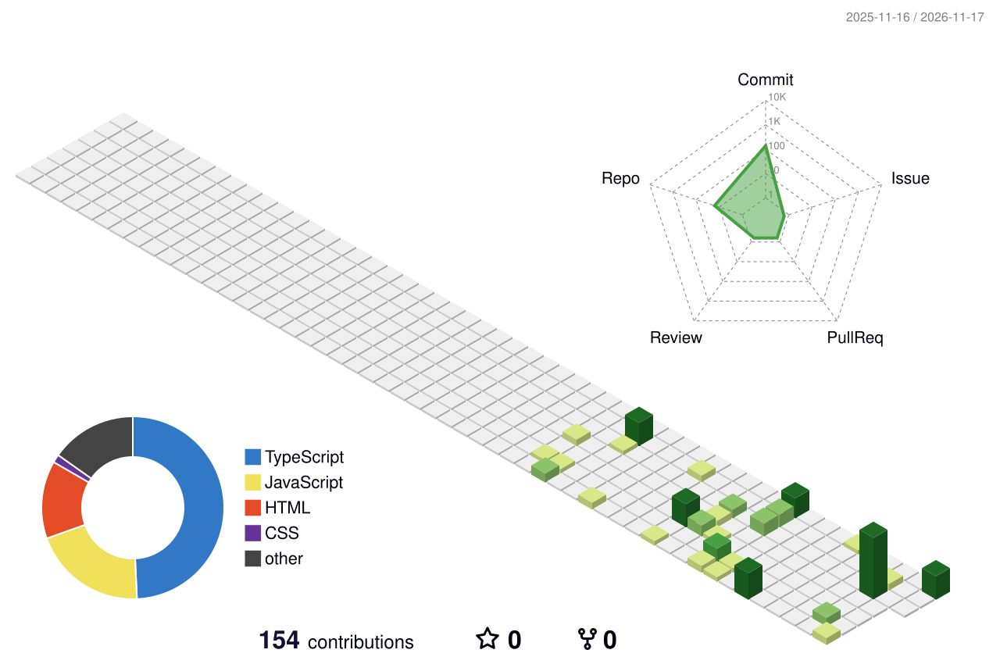

<!-- ronkon70/README.md — GitHub Profile README (FINAL). এই ফাইলটা portfolio-website repo-তে commit করবেন না! -->

  

  

 

## 🚀 About Me

I'm always learning to build <b>modern, responsive and user-friendly websites</b> that help businesses grow their online presence. I enjoy turning ideas into clean, fast and accessible websites.

- 🔭 Currently working on **freelance projects — Fiverr & direct clients**
- 🌱 Learning **Advanced React & Next.js (App Router)**
- 🎨 **12+ years** of visual design & photo retouching experience
- 💬 Ask me about **React, Next.js, TypeScript, Tailwind CSS, MongoDB**
- 📫 Reach me: **odesk.rokon@gmail.com**

 

## 🛠 Core Skills

  
  
  
  
  
  
  
  
  
  

## 🔥 GitHub Streak

  

## 📊 3D Contribution Graph

  

 

## 🤝 Connect With Me

  &nbsp;
  &nbsp;
  

